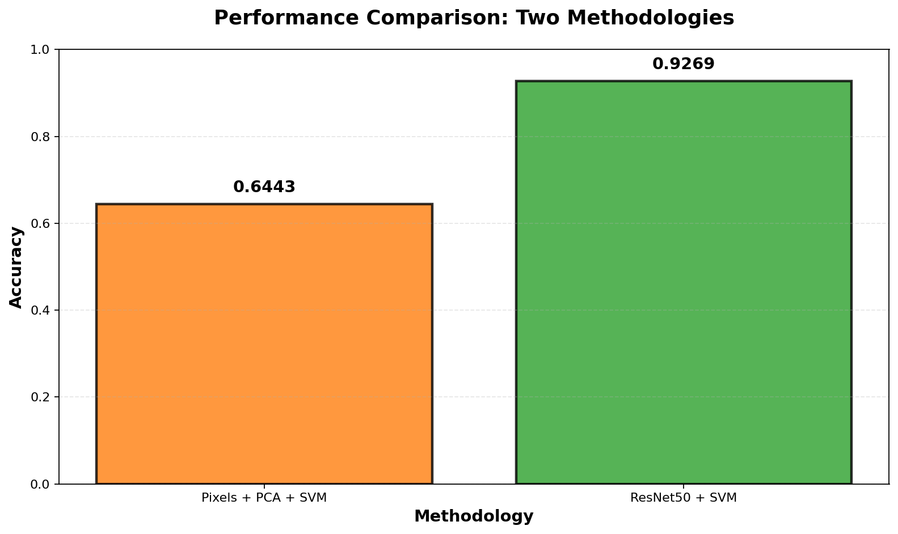
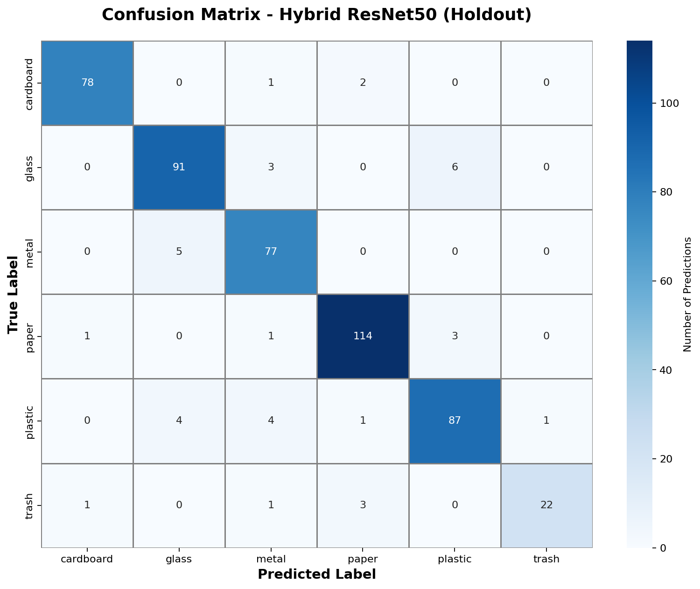

# Garbage Classification with Computer Vision

An undergraduate machine learning project by **Abdullah Al-Hamidi**, Universitas Islam Indonesia, comparing two approaches to six-class waste image classification:

1. **Pixel baseline:** RGB pixels at 64 x 64 -> StandardScaler -> PCA (95% variance) -> RBF SVM.
2. **Transfer learning:** frozen ImageNet-pretrained ResNet50 -> 2,048-dimensional image features -> RBF SVM.

The categories are **cardboard, glass, metal, paper, plastic and trash**. The project covers exploratory data analysis, image preprocessing, model comparison, five-fold cross-validation, confusion matrices and single-image inference.

## Explore the project

- [Executed notebook](notebooks/garbage_classification.ipynb)
- [Recorded metrics](reports/metrics.json)
- [Model comparison](reports/model_comparison.csv)
- [Image split manifest](reports/split_manifest.csv)
- [Dataset on Kaggle](https://www.kaggle.com/datasets/asdasdasasdas/garbage-classification)





## Verified results

The portfolio notebook was executed end to end on 27 October 2026: **2,527 images**, with **2,021 training images** and **506 held-out images**. All 19 code cells completed without errors.

| Method | Holdout accuracy | Macro F1 | Training CV mean +/- std |
|---|---:|---:|---:|
| Pixels + PCA + SVM | 64.43% | 0.6449 | 63.04% +/- 2.13 percentage points |
| ResNet50 + SVM | **92.69%** | **0.9210** | **90.85% +/- 0.50 percentage points** |

These are results on this dataset and split. Re-execution on other dependency versions or hardware may differ slightly. They are not evidence of performance on a real waste-sorting production line.

## Evaluation protocol

- Both methods use the **same stratified 80/20 train/holdout split**, with seed 42.
- Five-fold **stratified** cross-validation uses training data only.
- Scaling and PCA remain inside the scikit-learn pipeline, so each cross-validation fold fits preprocessing only on its training portion.
- ResNet50 weights are frozen. No model fine-tuning is performed.
- Feature extraction and evaluation use deterministic preprocessing without random image augmentation.
- The report includes accuracy and macro F1. The holdout is not used for hyperparameter tuning.
- The split manifest contains dataset-relative paths, not local computer paths.

## Run locally

The published execution was verified with Python 3.13 and TensorFlow 2.20. A compatible Python environment and sufficient memory for pixel PCA are required. The first run downloads the dataset and ImageNet weights; model training and cross-validation may take several minutes or longer depending on hardware.

```bash
git clone https://github.com/alhamidi1/garbage-classification.git
cd garbage-classification
python3 -m venv .venv
source .venv/bin/activate
python -m pip install -r requirements.txt
python -m ipykernel install --user --name garbage-classification --display-name 'Garbage Classification'
python -m nbconvert --to notebook --execute notebooks/garbage_classification.ipynb \
  --inplace --ExecutePreprocessor.kernel_name=garbage-classification \
  --ExecutePreprocessor.timeout=1200
```

On Windows, activate the environment with `.venv\Scripts\activate` instead. Alternatively, open the notebook in VS Code or Jupyter and select the installed environment. An existing dataset can be supplied with `GARBAGE_DATA_DIR`; it must contain the six category directories, directly or inside nested folders.

The notebook writes regenerated metrics and charts to `reports/`. To classify a custom image, run the training cells, then call:

```python
predict_image('/path/to/image.png')
```

RGB conversion supports grayscale and transparent input images. The function always returns one of the six known classes; it does not detect unknown objects.

## Repository structure

```text
notebooks/garbage_classification.ipynb  # Analysis, training, evaluation and inference
reports/metrics.json                  # Results from the published execution
reports/model_comparison.csv          # Accuracy, macro F1 and training CV results
reports/split_manifest.csv            # Shared split, dataset-relative filenames
reports/figures/                      # Evaluation charts
requirements.txt                     # Versions used for the published execution
```

## Scope and limitations

This is an **educational prototype**, not an operational recycling system. Dataset imbalance, isolated-object images and limited visual variety restrict generalization. Mixed waste, cluttered scenes, other camera conditions and unknown objects require separate evaluation. The repository does not claim IoT hardware integration, real-time deployment or production readiness. Dataset duplicate auditing and an independent external test set are future improvements.

The portfolio edition corrects the original coursework's inconsistent model splits and randomly augmented validation images, uses stratified folds, handles RGB inference consistently and removes unsupported production-readiness claims. The original local coursework files are preserved separately.

## Data and attribution

Dataset: [Garbage Classification by asdasdasasdas on Kaggle](https://www.kaggle.com/datasets/asdasdasasdas/garbage-classification). Review the dataset's terms before reuse. Raw dataset files, personal test images and pretrained weights are **not bundled**. The executed notebook includes a few dataset sample visualizations. ResNet50 ImageNet weights are obtained through TensorFlow/Keras. This repository contains the author's coursework code and its portfolio refinements.
